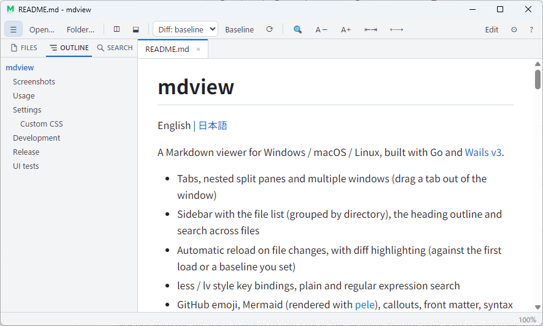
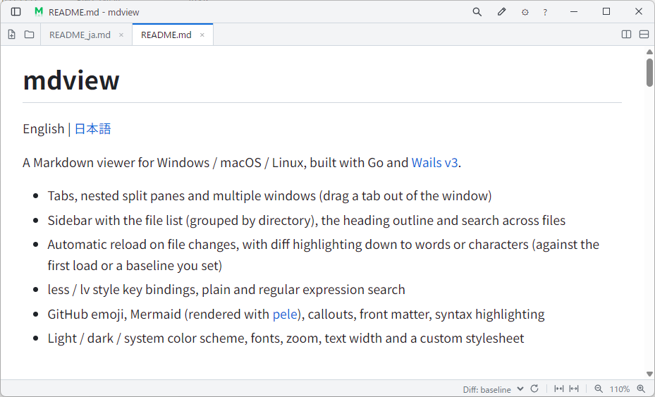
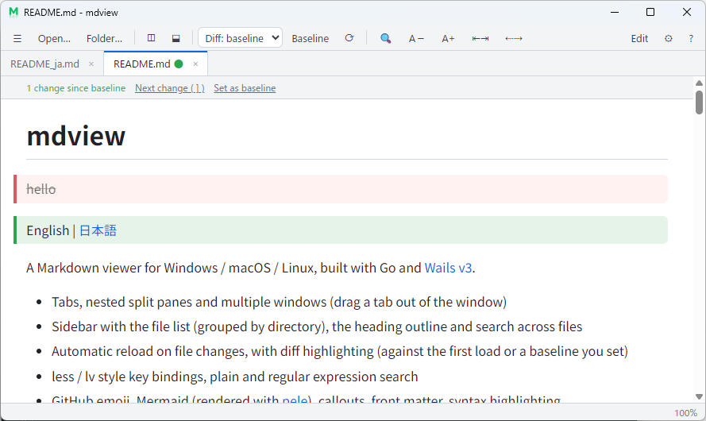
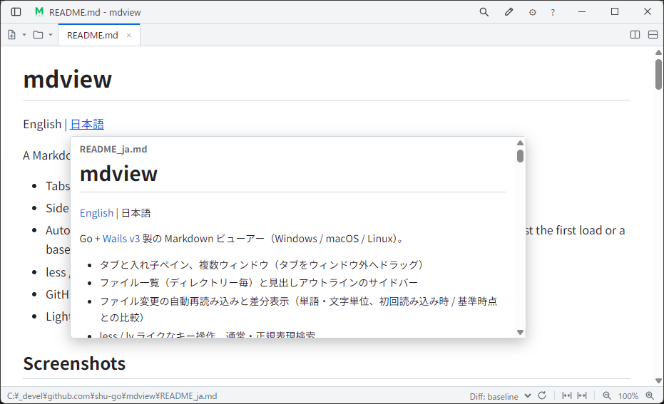

# mdview

English | [日本語](README_ja.md)

A Markdown viewer for Windows / macOS / Linux, built with Go and [Wails v3](https://v3.wails.io/).

- Tabs, nested split panes and multiple windows (drag a tab out of the window)
- Sidebar with the file list (grouped by directory), the heading outline and search across files
- Automatic reload on file changes, with diff highlighting down to words or characters (against the first load or a baseline you set)
- less / lv style key bindings, plain and regular expression search
- Link preview: `Ctrl` + hover on a link to a heading or another Markdown file shows it in a popup
- GitHub emoji, Mermaid (rendered with [pele](https://pele.run)), callouts, front matter, syntax highlighting
- Light / dark / system color scheme, fonts, zoom, text width and a custom stylesheet

## Screenshots

Sidebar (outline), tabs:



Without the sidebar:



Diff highlighting after the file changed:



Link preview (`Ctrl` + hover on a link):



## Usage

```
mdview [FILE|FOLDER]...
```

If mdview is already running, the files open in the window that was active last (single instance).
Files and folders can also be dropped on the window, or opened with `Ctrl+O` / `Ctrl+Shift+O`.

Main keys (`F1` shows them all):

| Key | Action |
|-----|--------|
| `j` `k` / `Space` `b` / `d` `u` | Scroll a line / page / half page (with a count, e.g. `5j`) |
| `g` `G` / `50p` | Top / bottom / 50 % |
| `{` `}` | Previous / next heading |
| `/` `?` `n` `N` / `Alt+/` | Search / regular expression search |
| `]` `[` / `D` / `B` | Next / previous change, diff on/off (last used mode), set the baseline |
| `t` `T` / `q` | Next / previous tab, close the tab |
| `Ctrl+1` – `Ctrl+8` / `Ctrl+9` | Tab at that position / last tab |
| `Ctrl+\` `Ctrl+Shift+\` | Split right / down |
| `Ctrl+B` / `o` | Show or hide the sidebar / cycle files → outline → search |
| `Ctrl` `+` `-` `0`, `Ctrl`+wheel / `(` `)` | Zoom / text width |
| `Ctrl+Shift+G` | Search all files (sidebar SEARCH) |
| `Ctrl+Q` | Quit |
| `v` | Open in the external editor (at the viewed line) |
| `Ctrl`+hover on a link | Preview the linked heading / Markdown file in a popup |

On macOS, `Cmd` is used instead of `Ctrl`.

## Settings

Settings are stored in `mdview.json`: next to the executable if such a file exists there,
otherwise in the user configuration directory (Windows: `%APPDATA%\mdview\mdview.json`).

The external editor is a command line in which `{file}` and `{line}` are replaced:

```
code -g "{file}:{line}"
"C:\Program Files\Vim\vim91\gvim.exe" +{line} "{file}"
```

### Custom CSS

Use Settings > Custom CSS > **Export template…** to save the built-in stylesheet, edit it, and choose it
as the Custom CSS (changes are applied when you save the file). Class names use the `mdv-` prefix with
hyphenated hierarchy:

```
.mdv-app > .mdv-toolbar, .mdv-main, .mdv-statusbar
.mdv-sidebar > .mdv-sidebar-files-group > .mdv-sidebar-files-item
.mdv-pane > .mdv-pane-tabs > .mdv-pane-tab
.mdv-doc > .mdv-content            (the rendered Markdown)
.mdv-callout-note, .mdv-code, .mdv-mermaid, .mdv-frontmatter, .mdv-diff-ins / .mdv-diff-del
```

States are expressed with `.is-active`, `.is-hidden`, `.is-current` and so on; colors come from the
`--mdv-color-*` variables.

## Development

Requirements: Go 1.26+, Node.js and the `wails3` CLI.

```
wails3 dev              # development mode
wails3 build            # bin/mdview(.exe)
go test ./...           # Go tests
cd frontend && npm test # frontend tests (vitest)
go run ./tools/chromacss > frontend/src/styles/highlight.css  # regenerate the highlighting CSS
```

## Release

Pushing a tag such as `v1.2.3` runs GitHub Actions (`.github/workflows/release.yml`): it builds for
Windows, macOS (amd64, arm64) and Linux and publishes a release whose notes list the commit titles since
the previous tag. Tags with a hyphen (e.g. `-rc1`) become pre-releases.

```
git tag v0.2.0
git push origin v0.2.0
```

The application icon is `build/appicon.png` (the .ico / .icns files are generated at build time).

## UI tests

A development build (built without the `production` tag, e.g. with `go build`) started with the
environment variable `MDVIEW_REMOTE_DEBUG_PORT=9222` opens the WebView2 remote debugging (CDP) port
(Windows). Production builds (`wails3 build`) never open it.
